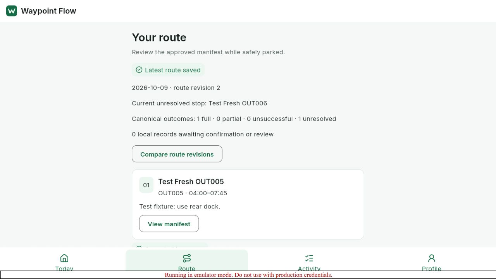
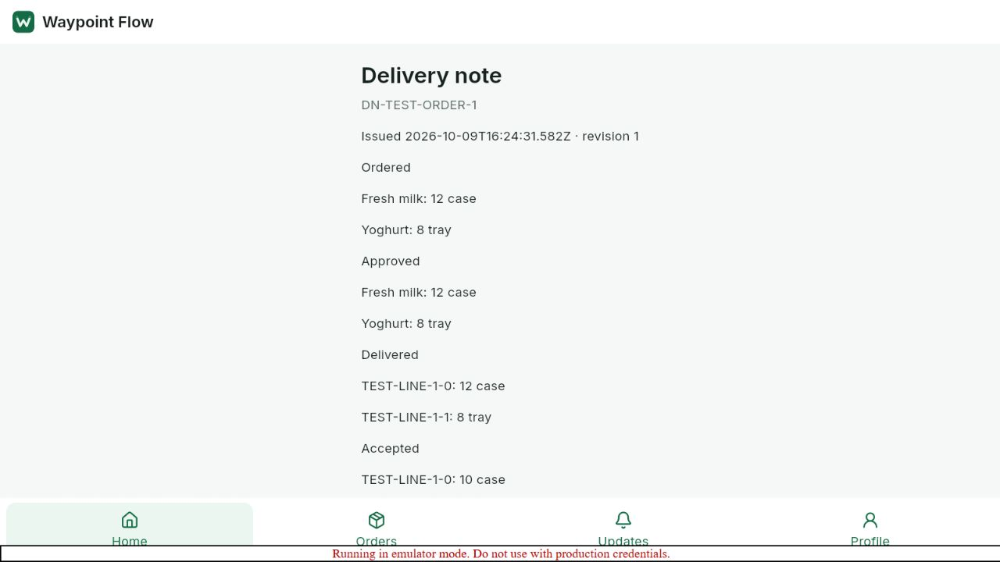
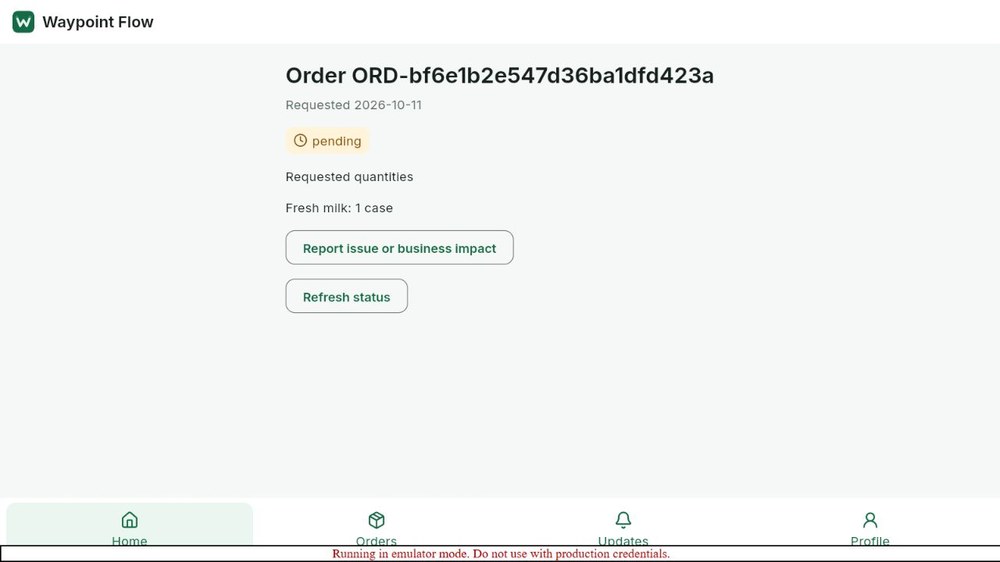

# Role workflow verification — 9 October 2026

Status: **Implemented — verification pending**. Local connected browser journeys and regression checks passed. This is not hosted, physical-device or release certification.

## Environment and scope

Website: `http://127.0.0.1:3002`; Flutter browser app: `http://localhost:4183`. Both used isolated Firebase project `demo-waypoint-mobile`, Firestore port 8085 and Auth port 9099. Synthetic accounts, orders and a synthetic PNG were used. No production sample transactions were performed.

The user requested the mobile app in Chrome instead of an Android emulator. The Flutter web build ran in the Codex in-app Chromium browser. External Chrome could not be launched: automatic approval review rejected the launch, and the browser tool exposed no external Chrome connection. The same local URL can be opened manually in Chrome. No Android-emulator result is counted in this run.

## Browser journeys

| Role / action | Observed result |
|---|---|
| Website Loader login, report shortfall against Stop 2 | Inline form accepted the report; trip held and departure blocked |
| Website Dispatcher login, Control, shortfall approval | Revised manifest accepted; report resolution recorded |
| Website Loader load checks and explicit release | All stop loads alone leave trip unreleased. Release stays disabled until all four departure checks are checked. Explicit release succeeds |
| Mobile Driver login, session reload, approved route, start | Ready route starts after parked acknowledgment; current status becomes on route |
| Mobile Driver full delivery, recipient, synthetic image, three-stage review | Retained photo and proof saved; automatic sync reaches **Accepted by server**, one canonical full outcome and zero local records awaiting confirmation |
| Website Driver login | Same canonical one-of-two completed count and next-trip closeout gate |
| Website Store login and receipt difference | Delivery visible; 12 milk cases delivered, 10 accepted, reason recorded. Stable `DN-TEST-ORDER-1`, revision 1, discrepancy shown; delivery timeline remains delivered after receipt |
| Website Store Updates | Real committed receipt/delivery notifications shown. Mark read changes latest receipt update to Read |
| Mobile Store login, order detail and digital note | Original detail-screen crash reproduced, fixed and rechecked. Same delivery note/reference and accepted quantities render after session reload |
| Mobile Store order composition and submission | Eligible service date selected explicitly; one milk case submitted. Server order `ORD-bf6e1b2e547d36ba1dfd423a` appears pending and detail shows one case |
| Website Dispatcher overview | Two canonical trips, one-of-one vehicles, one-of-two enabled drivers assigned; receipt exception links to Control |
| Website planning | List and draft controls rendered; no current-day eligible unassigned orders. Allocation/publish browser rehearsal remains pending; HTTP tests cover guarded plan reads and publish retry |

Automated tests reseed the stable fixture records. Old synthetic event/history documents can remain in the local database. Screenshots record the journey before reseeding; final preparation restores enabled test accounts and ready sample routes. Synthetic checklist confirmations do not certify actual vehicle inspection.

## Fixes

- Loading a stop preserves shortfall holds and never automatically releases a trip. Dispatcher shortfall approval also requires subsequent explicit Loader release. Shared `releaseTrip` checks depot, active manifests, holds and all four confirmations, records actor/time and is idempotent.
- Loader failures remain visible; successful server state controls checkboxes. Shortfall reporting uses an inline affected-stop form, with one descending load sequence.
- Dispatcher metrics derive from canonical records. Exception dismissal checks current principal/depot and cannot bypass shortfall or breakdown review. Review links open Control.
- Planning HTTP failures appear with a retry action.
- Store Updates uses scoped paginated notification APIs and persisted read state, replacing invented arrival messages.
- Mobile order reads normalize the shared `{order, exceptions}` envelope before encrypted caching and on offline cache recovery. Added regression exercises real HTTP decoding plus encrypted offline fallback.
- Website receipts show actual outlet, product names, original ordered quantities, full order reference and truthful discrepancy/delivery state. Driver release text and account footers no longer claim invented staff verification or browser-only demo records.
- Development-only login diagnostics expose error categories/status codes, never credentials or tokens.

## Actual checks

Flutter commands ran from an isolated copy at `C:/wf-mobile-qa-20261009` because OneDrive locked existing build/hook files. Changed sources/tests were copied back; source format check ran in the repository.

| Command | Result |
|---|---|
| `dart format --output=none --set-exit-if-changed lib test integration_test` | 54 files, zero changes, exit 0 |
| `flutter analyze --no-pub` | No issues |
| `flutter test --no-pub` | **58 passed**, including order envelope/offline cache regression |
| `flutter build web --debug --no-pub --dart-define-from-file=config/chrome-emulator.json --output=build/web-final` | Passed; corrected build served on 4183 and UI retested |
| `npm run typecheck` | Passed after final website edits |
| `node node_modules/tsx/dist/cli.mjs --test tests/mobile-service.test.ts` | **5 passed**, including shared cross-role lifecycle, holds, receipt/replay, review/media scopes, deferral/restoration and metadata audit |
| `node node_modules/tsx/dist/cli.mjs --test tests/mobile-http.test.ts` against 3002 | **1 passed**: four website roles, mobile identity, wrong-role redirects, outlet/depot denial, release checks/idempotency, unsafe origin denial and driver/dispatcher revocation |
| `git diff --check` | Passed |

Emulator startup required Java 21 and short Windows Unix-domain socket path via `-Djdk.net.unixdomain.tmpdir=C:/wf-jtmp`. This is a local runtime workaround, not an application change.

## Evidence

## Remaining acceptance gates

- External Chrome itself was not automated; browser storage quota, real camera, offline/reload/process-kill matrix and production web release remain unverified.
- Hosted HTTPS/Auth/Firebase/private S3 upload/finalize/view remains pending. The previously recorded real S3 **403 AccessDenied** is not resolved by local-emulator success.
- Full browser planning allocation/publish and all secondary administration screens are not certified by this rehearsal.
- Physical Android/iPhone, Apple toolchain/signing, real receiving/vehicle policy approval and production release/install gates remain open.

Phases 2–6 remain **Implemented — verification pending**; Phase 7 remains **In progress**. Complete exit-gate count remains 0/10.
